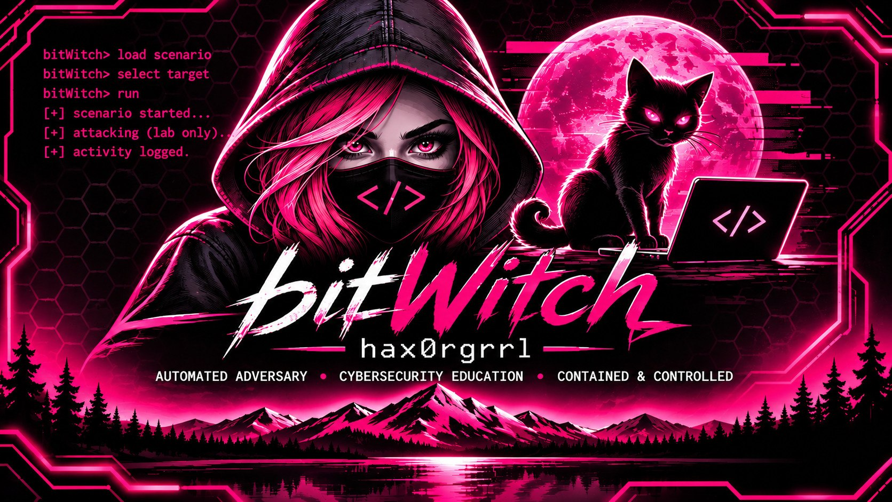

<div align="center">



**Automated Adversary • Cybersecurity Education • Contained & Controlled**

</div>

# bitWitch 🪛

A web front end for attack runs against the lab. Pick an attack, type a target,
watch the output stream. Built to replace a heavyweight Kali VM with something
students can actually reach from a browser.

## What it is, and what it is not

It is a **runner**, not a wrapper around one tool. Every attack is a small
plugin file that either gathers data or asserts a claim, and says which it did.

It is **not** a scanner with a curated "safe" list bolted on. There are no
target restrictions in the attacks themselves. The boundary is the classroom:
by default a student can reach anything the container can, the same as having a
terminal on a Kali box. An admin can narrow that (see Scope below).

## Roles

Two roles, decided at sign-in.

**Student** — your name and the class password. Leave the admin password blank.
You get the attack menu and a target field.

**Admin** — the class password *plus* the admin password. You get a `/admin`
page where you set the target scope.

The role is carried inside the signed session cookie, so a student cannot
promote themselves by editing it. (Tested: changing `student` to `admin`, or
renaming yourself to an admin, both invalidate the signature and drop you back
to the login page.)

## Scope

By default there is **no scope** and the page says so: *no scope set — anything
reachable*.

An admin can set a list of networks. Once set:

- targets inside the list run normally
- targets outside it are refused with an explicit reason
- hostnames are refused while a scope is set, because the scope is compared as
  addresses — an IP is required

Leaving the field blank removes the limit. The state is written to
`/data/scope.json` and survives restarts.

Why an admin sets this and not a constant in the source: I do not know which
network a given class runs on, and hardcoding a guess means rebuilding an image
every time the room changes.

## Running it

**Two** prerequisites and two steps, for a machine that has only Docker on it.
This file used to say one prerequisite and it was wrong: `docker compose` is a
separate package from `docker.io` on Debian, and without it step 3 dies with
exit 125 and builds nothing. That is the install failing, not the app failing,
so it is written out here rather than left to the error message.

The two steps that fail *silently* (signing everyone out on restart, and
running old code from a stale image) are written out instead of assumed.

### Prerequisite 1: Docker

```bash
sudo apt-get install -y docker.io
```

### Prerequisite 2: the compose plugin - this is the one that bit us

Debian's `docker.io` package does **not** ship `docker compose`. It is a
separate package, and it is a *Recommends* at best depending on how you
installed Docker, so `--no-install-recommends` leaves it out entirely. Check
before you clone:

```bash
docker compose version
# Good:      Docker Compose version v2.x.y
# Bad:       docker: 'compose' is not a docker command.
```

If it says `is not a docker command`, install the plugin:

```bash
sudo apt-get install -y docker-compose-v2
# or, if that package does not exist on your release:
sudo apt-get install -y docker-compose-plugin
```

Then re-run `docker compose version`. Do not continue until it prints a
version. Every `docker compose ...` command in this README will fail with
exit 125 until this is installed.

```bash
git clone <repo> bitwitch && cd bitwitch

# 1. .env — the compose file refuses to start without BITWITCH_PASSWORD
#    (`:?set BITWITCH_PASSWORD in .env`), and a blank BITWITCH_SECRET makes
#    every restart sign all students out.
cp .env.example .env
sed -i "s/^BITWITCH_SECRET=.*/BITWITCH_SECRET=$(openssl rand -hex 32)/" .env
# then edit .env and set BITWITCH_PASSWORD (and BITWITCH_ADMIN_PASSWORD if
# the instructor should be able to set a target scope).
```

**2. the network — nothing to do by default.** `docker-compose.yml` creates
`labnet` itself (`external: false`). You only need this step if you want the
container on an *existing* lab network that Trapdoor's ports are on — for
example when `labnet` is already managed by another stack, in which case
compose cannot create a second network with the same name:

```bash
# only if the network already exists and is managed elsewhere
sed -i 's/^BITWITCH_NETWORK_EXTERNAL=.*/BITWITCH_NETWORK_EXTERNAL=true/' .env
# and make sure BITWITCH_NETWORK names it
```

#### If the container cannot reach a service on the host

Symptom: you point a scan at `http://<host-ip>:<port>` and the app times out,
while `curl` from the host itself gets a 200. If the host runs `ufw`, the
docker bridge interface is being filtered and the container's traffic to the
host is dropped.

Allow traffic in on the docker bridge interfaces:

```bash
sudo ufw allow in on docker0
# and for compose-created networks, whose interface names start with a "br"
# followed by a dash. The split below is ugly on purpose: it keeps the README
# free of a literal interface prefix that someone could paste as a fixed name.
BRPREFIX="br$(printf '%s' -)"
sudo ufw allow in on "$(ip -o link show | awk -F': ' '{print $2}' | grep "^${BRPREFIX}" | head -1)"
```

**Do not hard-code a bridge name.** Docker derives the compose bridge interface
name from the network's id, and that id changes every time the network is
recreated. A rule written against one specific interface stops working the
next time you rebuild the stack, and it still shows as active in `ufw status`
while it silently drops everything. Look the interface up at the moment you
need it, as above, instead of pasting the name from an old run.

This is a host firewall rule for a host firewall. It is not the app's scope
control, and it does not widen what students can scan - the scope in
`/admin/scope` still applies inside the container.

```bash
# 3. build with the commit stamped in, then start
GIT_COMMIT="$(git rev-parse HEAD)" \
GIT_DIRTY="$([ -n "$(git status --porcelain)" ] && echo 1 || echo 0)" \
BUILT_AT="$(date -u +%Y-%m-%dT%H:%M:%SZ)" \
  docker compose up -d --build
```

Then open `http://<host>:8099`, and check what you are actually running:

```bash
curl -s http://localhost:8099/api/version
# {"commit":"<sha>","dirty":false,"built_at":"<utc>"}
```

If `commit` is `null` the image was built without a stamp and **the app will
not serve** — that refusal is deliberate. See *Version stamping* below.

`.env` holds passwords. It is gitignored. Do not commit it.

## Attacks

Each file in `app/attacks/` is one attack, auto-discovered at startup. The
contract is small:

```python
NAME = "unique_id"
LABEL = "Human label shown in the menu"
DESC = "One line about what it does"
CATEGORY = "recon" | "scenario" | "decoy" | "instrumentation"
NEEDS_PORT = True | False

def run(target, port, emit, path="/", protocol="ssh") -> dict:
    emit("a line of output")
    return {"status": "pass" | "fail" | "blocked" | "complete", "summary": "..."}
```

Four statuses, and the difference between them is the point:

| status | means |
|---|---|
| `complete` | gathered data, made no claim (recon) |
| `pass` | asserted a claim, the claim held |
| `fail` | asserted a claim, it did not hold |
| `blocked` | a precondition failed, **nothing was tested** |

Optional parameters (`path`, `protocol`) can be added to a module's signature.
They are passed only to modules that declare them, so an attack that ignores
them is unaffected. The job runner inspects the signature rather than catching
`TypeError`, because a `TypeError` raised *inside* an attack would otherwise
look identical to an attack that does not accept the parameter.

`blocked` exists because a check that cannot fail reads exactly like a check
that passed. If a tool is missing, or the port is closed, or the target does not
resolve, the honest answer is that no test happened — not "pass," and not
"fail." A missing binary is `blocked`, never `fail`: the fault is the
container's, and reporting it as a target failure would put a red mark on the
wrong thing.

Raise `Blocked("reason")` for a precondition failure; return a `pass`/`fail`
verdict for an actual test.

### Current modules

**Recon** — gather data, assert nothing.

- `nmap_discover` — TCP connect scan, top 200 ports
- `banner_grab` — connect and read what the service says first
- `dir_bust` — gobuster against a web root, curated path list
- `nikto_scan` — known-misconfiguration scan, time-boxed to 180s

**Web**

- `sql_check` — sqlmap on one URL. **Refuses** a URL with no query parameters:
  sqlmap's "no injectable parameters" against `http://host/` means nothing was
  looked at, not that the target is clean, and that false negative is the usual
  classroom outcome.

**Scenario** — loud, fast, the way an attacker actually behaves.

- `hydra_brute` — ssh/ftp/http-get, 5 usernames × 32 passwords, capped at 60
  attempts, stops on first hit. Deliberately unreproducible so the contrast with
  the scripted run below is visible in the log.
- `ssh_cred_sequence` — fixed credential list in fixed order; expects
  rejections then one acceptance, and fails if the shape is wrong

**Trapdoor checks** — written against the honeypot's own acceptance list.

- `trapdoor_web_sweep` — the exact request set and order from
  `scenarios/web-scan.sh`, including the `/login` → 401 endpoint that the
  reference list does not cover. Checks claims C1–C6.
- `trapdoor_ssh_bruteforce` — the scripted credential attack from
  `scenarios/ssh-bruteforce.sh`, plus an exact-match check on the configured
  banner (`SSH-2.0-OpenSSH_9.2p1 Debian-2+deb12u2`, claim A6/B1). Graded, not
  just printed: it fails if the accepted credential arrives before any
  rejection, because then the lesson — fail, fail, fail, then get in — is gone
  even though every step "worked."

**Interaction**

- `tcp_talk` — connect, read the greeting, send a few lines, record everything.
  This is what makes a self-outing telnet banner visible in one line.
- `decoy_telnet_banner` — does a decoy name itself to anyone who connects
- `decoy_wp_facade` — is `/wp-login.php` baited while `/wp-content/` 404s

### A note on nikto

**There is no default target, and v0.1 does not ship one.** Nikto needs a host
to point at, and naming one would mean deciding whose server this lab scans.
That is a decision about somebody else's machine, so it is **declined, not
unverified**: this release has no bundled target, no demo host, and no
"just press run" example. The operator names a target, and the admin sets a
scope before students can run anything outside it. A live-target mode, where
the appliance ships with somewhere to aim, is v1.0 work and needs a host that
belongs to this farm.

Nikto is **not packaged in Debian**, so the image clones it from source and
installs the Perl modules it needs. One of those, `XML::Writer`, must be named
explicitly — without it nikto exits with "Required module not found" before it
scans anything, which looks exactly like a clean scan if you are only reading
the exit code. The Dockerfile runs `nikto -Version` at build time so this fails
the build instead of the classroom.

## Logs

Every run appends one JSON line to `/data/runs.jsonl`: timestamp, job id,
attack, target, port, operator, **scope reason**, status, summary, elapsed time,
whether output was truncated.

The scope reason is recorded so that three weeks later a line reading
`"scope": "allowed: no scope set"` explains itself, where a bare `"allowed"`
would not.

## Limits, by design

- Output is capped per run (4000 lines / 400KB) so one runaway scan cannot fill
  the disk or wedge a browser tab.
- Jobs run in a thread per run and are held in memory; the durable record is the
  JSONL log.
- `BITWITCH_SECRET` left blank means sessions are signed with a random key
  generated at boot, so restarting the container signs everyone out. Set it to
  keep sessions across restarts.

## Status

**v1.0 — declared done by Robbie on 2026-11-12.** This version is closed. New
work belongs in the next project, not in this tree.

Built and tested against live targets: 13 attack modules, auth, roles, scope
enforcement, cookie forgery resistance, and the run log. Deployed at
`http://192.168.111.34:8099` on the test box, commit `8935a01`.

**27 regression tests.** The count depends on where you run them, and the
number is quoted with its environment because a total that quietly shrinks is
worse than a red one:

    # in the container — the full 27, nothing skipped
    docker compose exec -T bitwitch python3 -m unittest discover -s tests
    # -> Ran 27 tests  OK

    # a fresh clone on a host, no installs — 21 run, 6 skip
    python3 -m unittest discover -s tests
    # -> Ran 27 tests  OK (skipped=6)

    # a fresh clone with the test deps installed — the full 27
    python3 -m pip install -r requirements-test.txt
    python3 -m unittest discover -s tests
    # -> Ran 27 tests  OK

The six that skip without dependencies are the cookie-integrity tests: they
exercise `app.main`, which imports FastAPI and python-multipart at module
scope. Without those packages they **skip with a stated reason** rather than
erroring, because an error says "the checkout is broken" and a skip says "you
did not install the test dependencies" — and only one of those is true.

**Do not quote "21 passing" as the regression count.** Those six are the
security tests. A total that drops them silently is the exact failure this
paragraph exists to prevent.

They cover the status vocabulary, the scope gate, cookie forgery, the module
contract, the error paths of every attack module, and the hardcoded Trapdoor
expectations. They are stdlib `unittest`; `requirements-test.txt` exists only
for the FastAPI-dependent six.

## Version stamping

The image knows which commit it is, and says so at `GET /api/version`:

    {"commit": "<sha>", "dirty": false, "built_at": "<utc iso8601>"}

`GET /api/health` is liveness only and deliberately does not report a version,
so a restart cannot be mistaken for a deploy.

**Why this exists.** `docker compose up -d` without `--build` reuses the
previous image. A fix that was committed but never rebuilt runs the *old* code
while `git log` shows the new commit, and from outside the box those two states
are identical. Two people can then compare notes about the same live URL and
both be right about different software.

**Unstamped builds refuse to serve.** If `GIT_COMMIT` is absent at build time
the image still builds, but startup raises and the process exits non-zero.
An instance that cannot say what it is running is not a deployment, and a
200 from it is a claim nobody can reproduce.

`BITWITCH_ALLOW_UNSTAMPED=1` is a local-development escape hatch only. It
serves, logs a warning, and reports `commit: null` so the exception is visible
from outside.

**Verified against the live Trapdoor honeypot at `192.168.111.45`:**

- `trapdoor_web_sweep` → pass. 11 bait paths 403, absent path 404, `/login` 401.
- `trapdoor_ssh_bruteforce` → pass. 5 rejections, then accepted as `root`.
  Banner is the exact configured string.
- `tcp_talk` on Cowrie:2222 → complete. The greeting is a bare login prompt.
- `dir_bust` → 12 paths, including all the bait files at 403.
- `nikto_scan` → 17 findings in 9 seconds.
- `hydra_brute` → `root:123456` accepted after 4 loud attempts.
- `sql_check` → correctly refuses a URL with no parameters.

## Deploying (read this before you touch the test box)

The test box at `/opt/bitwitch` is **not a git checkout** — it is a plain copy of
the tree. `git pull` there does nothing and never did. Static files are **baked
into the image**, not bind-mounted, so a code change is invisible until the image
is rebuilt.

To ship a change:

    # from the dev tree
    scp static/style.css root@<box>:/opt/bitwitch/static/style.css

    # on the box
    cd /opt/bitwitch && docker compose up -d --build

A hard refresh (Ctrl-Shift-R) is required afterwards — the stylesheet is cached
aggressively and an ordinary reload will show the old CSS.
